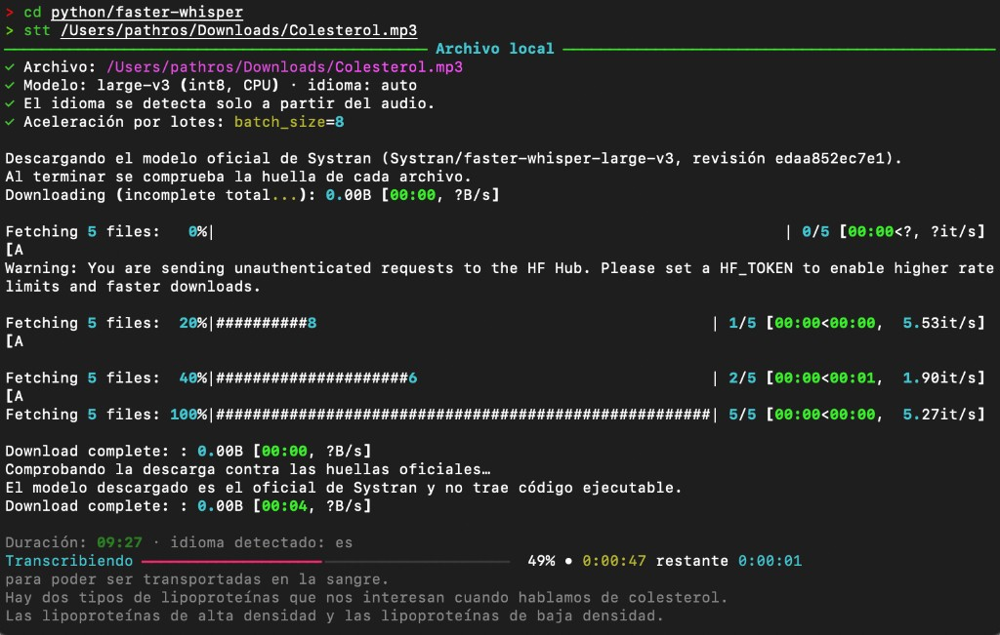
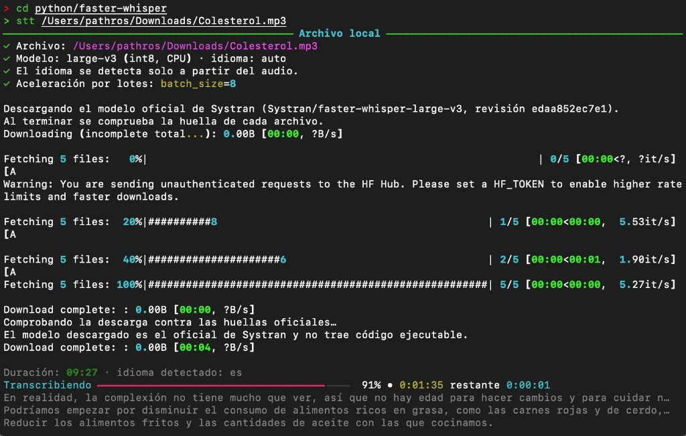
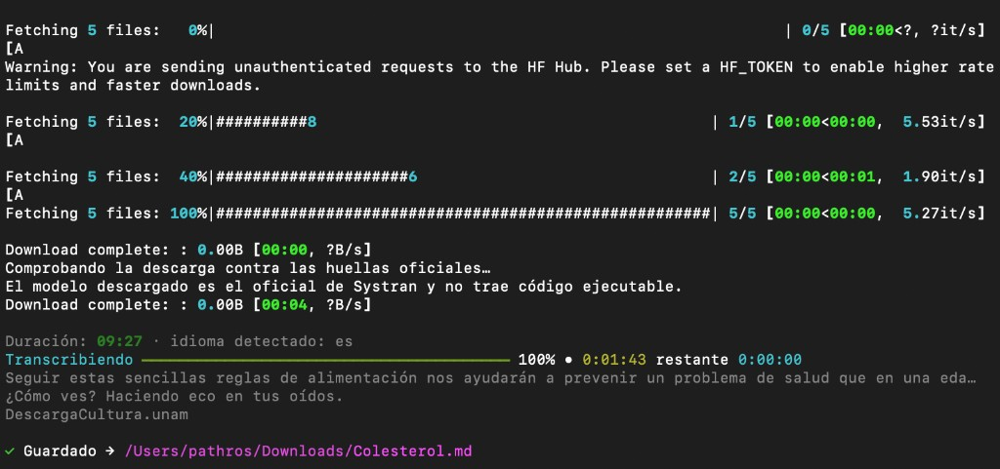

# stt — Speech To Text

Transcribe audios y videos en la propia computadora con [faster-whisper](https://github.com/SYSTRAN/faster-whisper). El idioma se detecta solo. Mientras avanza se ven la barra y unas líneas del texto. El archivo queda en **Descargas**, en Markdown o en Word.

También descarga captions de YouTube y genera podcasts de audio a partir de guiones Markdown.

## Así se ve

La primera vez comprueba y descarga el modelo oficial. Después transcribe y muestra el texto en vivo. Al terminar, guarda el archivo.







Las capturas son de macOS. En Windows la ventana hace lo mismo: barra, texto en vivo y archivo en Descargas.

## Lo mismo en macOS y en Windows

| | macOS | Windows |
|---|---|---|
| Transcribir audio o video local | Sí | Sí |
| Idioma automático | Sí | Sí |
| Texto en vivo y barra de avance | Sí | Sí |
| Word (`.docx`) | Sí, con `-f docx` o en la configuración | Sí. El instalador lo deja así |
| Elegir carpeta de salida | Sí: `-o` o `stt configurar` | Sí: icono **Configurar-transcripcion** |
| Carpeta por defecto | Descargas (`~/Downloads`) | Descargas |
| Formato por defecto | Markdown (`.md`) | Word (`.docx`) |
| Arrastrar el audio a un icono | No. Se usa la terminal | Sí: icono **Transcribir** |
| Separar quién habla | Si la memoria alcanza | Si la memoria alcanza |
| Podcast con voz del sistema (`say`) | Sí | No. En Windows el podcast usa voces en línea (`edge`) |

## macOS

Requisitos: Python 3.12 o más reciente, y ffmpeg (`brew install ffmpeg`).

```bash
cd ruta/al/proyecto
pip install -e .
stt ~/Downloads/entrevista.mp3
```

Word y otra carpeta, solo en esa corrida:

```bash
stt ~/Downloads/entrevista.mp3 -f docx -o ~/Downloads
```

Para dejarlo fijo: `stt` → opción 4 (configuración), o `stt configurar`. Ahí se eligen carpeta y formato. Enter en la carpeta usa Descargas.

## Windows

Instrucciones para abrir sin Markdown: [INSTALACION-WINDOWS.txt](INSTALACION-WINDOWS.txt) (Bloc de notas) y [INSTALACION-WINDOWS.docx](INSTALACION-WINDOWS.docx) (Word).

1. Descargue el ZIP de la versión [v0.1.0](https://github.com/pathros/stt/archive/refs/tags/v0.1.0.zip). No use la rama `main`.
2. Huella SHA-256 de ese ZIP: `918bb5c88f4d3623ffbd7dc14ee2bd0bc567f74a9980236b0ec71b2708c8e8cb`.
3. Extraiga y doble clic en **`Instalar.bat`**. Si Python o uv ya están, no los vuelve a instalar.
4. En el Escritorio, arrastre el audio encima de **Transcribir**.

El Word queda en Descargas. Para otra carpeta o para pasar a Markdown: doble clic en **Configurar-transcripcion**.

La instalación descarga el modelo de **Systran** en una revisión fijada y comprueba la huella de cada archivo. `model.bin` tiene que ser CTranslate2, no un programa ejecutable. Si no coincide, no se abre.

## Cómo transcribir

### Menú interactivo

Sin argumentos abre el menú guiado:

```bash
stt
```

Opciones: archivo local · YouTube · podcast · configuración · salir.

### Archivo local

```bash
stt ~/Audio/entrevista.m4a
stt ~/Audio/entrevista.m4a -f md,srt -t
stt demo.wav --minutes 2          # solo los primeros 2 minutos
```

Extensiones reconocidas: `.mp3`, `.m4a`, `.opus`, `.wav`, `.flac`, `.aac`, `.ogg`, `.mp4`, `.mkv`, `.webm`.

Idioma desconocido: deja `-l auto` (default) o omítelo; Whisper lo detecta.  
Si ya sabes el código ISO: `-l es`, `-l uk`, `-l en`, etc.

### VAD (Voice Activity Detection)

**VAD** = detector de actividad de voz. Recorta silencios y tramos que no parecen habla, para acelerar y evitar basura.

| Tipo de audio | ¿Usar VAD? | Ejemplo |
|---------------|------------|---------|
| Reuniones (Zoom, Meet), entrevistas, podcasts hablados | **Sí** (default) | `stt reunion.m4a` |
| Canciones, música con letra, karaoke | **No** (`--no-vad`) | `stt cancion.wav -l uk --no-vad` |

En música el VAD suele tirar casi todo el audio (solo quedan 1–2 líneas). Con `--no-vad` también se evita condicionar en el texto previo, que en canciones produce alucinaciones típicas (“субтитры…”, “thanks for watching”, etc.).

## Separar voces (opcional)

faster-whisper no distingue quién habla. Para una entrevista o un podcast se puede añadir, aparte, el modelo local `pyannote/speaker-diarization-community-1`. Marca turnos (`Hablante 1`, `Hablante 2`). No adivina el nombre real.

No viene instalado. Ocupa unos **6 GB** de disco (PyTorch de CPU y el modelo) y hace falta una computadora con **al menos 12 GB** de memoria. La transcripción y la separación corren una después de la otra.

Al instalar (`Instalar.bat` o `stt configurar`) el programa escribe un dictamen: si **este** equipo puede instalarlo o no. Si no puede, la transcripción normal no cambia.

```bash
stt voces                         # dictamen y, si cabe, instalación
stt entrevista.m4a --speakers 2
stt entrevista.m4a --speakers 2 --names "Ana,Luis"
stt entrevista.m4a --speakers     # estima cuántas personas hay
```

`--names` sigue el orden en que empiezan a hablar. En el menú (`stt` → archivo local) también pregunta; la respuesta por defecto es no. Arrastrar el audio al icono **Transcribir** no separa voces.

La primera descarga del modelo pide una cuenta de Hugging Face, aceptar las condiciones en [speaker-diarization-community-1](https://huggingface.co/pyannote/speaker-diarization-community-1) y un token de lectura. Se guarda en `config/hf_token` (no se sube a git). Después el audio no sale de la computadora.

En Markdown y Word cada turno queda como `**Ana:** texto`. En JSON, el segmento trae `speaker`. Si una frase junta a dos personas, se asigna a quien más tiempo ocupó ese tramo.

```bash
# Reunión / podcast hablado (VAD activado)
stt ~/Downloads/zoom-call.m4a -l es -f md

# Canción en cualquier idioma
stt ~/Music/track.wav -l auto --no-vad
stt ~/Music/track.wav -l uk --no-vad -f txt,srt -t
```

### YouTube (video o playlist)

Primero intenta captions del video; si no hay, usa Whisper.

```bash
stt "https://www.youtube.com/watch?v=…"
stt youtube "https://youtu.be/…" -f txt,srt
stt "https://…" --whisper           # fuerza Whisper (ignora captions)
stt "https://…" --with-most-rated-comments      # top 10 comentarios (default)
stt "https://…" --with-most-rated-comments 25   # top N configurable
stt "https://…" --cookies-from-browser chrome   # anti-bot (playlist larga)
stt "https://…" --cookies-from-browser safari
```

Si el enlace trae video y playlist, el menú pregunta qué procesar.  
Con `--with-most-rated-comments`, en playlists se guardan los comentarios top de **cada** video (`*-comments.md` junto a la transcripción).

Si tras varios videos YouTube responde *Sign in to confirm you're not a bot*, usa `--cookies-from-browser` (sesión abierta en ese navegador) o `--cookies archivo.txt`.

## Formatos de salida

| Formato | Descripción |
|---------|-------------|
| `txt`   | Texto plano en párrafos (apto para Word: sin salto por cada frase) |
| `md`    | Markdown con párrafos por pausas |
| `docx`  | Documento Microsoft Word (abre directo en Word) |
| `srt`   | Subtítulos SubRip |
| `vtt`   | WebVTT |
| `json`  | Segmentos con `start` / `end` / `text` |

Varios a la vez: `-f md,srt,json` o `-f docx`.  
`-t` / `--timestamps` añade marcas de tiempo donde aplique; `--no-timestamps` las omite.

En macOS el archivo por defecto es Markdown. En Windows, el instalador deja Word. En los dos se cambia con `-f docx`, `-f md` o `stt configurar`.

Salida por defecto en los dos sistemas: la carpeta Descargas (`~/Downloads`).

### Rendimiento y puntuación (CPU)

Whisper **sí puntúa** de fábrica (`medium` / `large-v3`). Si el texto “parece sin puntuación”, suele ser por mirar salidas muy fragmentadas o un modelo más chico (`tiny`/`base`).

En CPU (p. ej. i5 + 16 GB) un audio de ~2 h con `medium` puede tardar **cerca de la duración del audio** (a veces más): es esperado.

| Ajuste | Efecto |
|--------|--------|
| `model`: `small` | Más rápido, algo menos calidad/puntuación |
| `model`: `medium` | Equilibrio recomendado en oficina |
| `beam_size`: `2` | Buen atajo de velocidad; poca pérdida vs `5` |
| `beam_size`: `5` | Un poco mejor, más lento |
| `batch_size`: `8` | Lotes en CPU (habla + VAD); suele ~1.5–2× |
| `batch_size`: `0` | Desactiva lotes (p. ej. depuración) |
| `language`: `es` | Más estable/rápido que `auto` si el audio es español |
| `vad_filter`: `true` | Salta silencios (recomendado en habla) |
| `--no-vad` | Canciones/música; sin lotes (el batch necesita VAD) |

## Podcast (texto → audio)

Genera un archivo de audio a partir de un guion `.md` con front matter YAML.

```bash
stt podcast guion.md
stt podcast guion.md -f m4a --rate 180
```

Formatos de audio: `m4a` (default), `mp3`, `wav`.

### Ejemplo de guion

```markdown
---
title: Mi episodio
language: es-MX
engine: say          # say (macOS) o edge (voces neuronales en línea)
pause: 0.4
voices:
  ANA: Paulina
  LUIS: Reed
---

**ANA:** Hola, bienvenidos al episodio de hoy.

**LUIS:** Gracias Ana. Empezamos con las noticias.
```

También acepta monólogo (`voice: Paulina`), `speakers:` / `speaker:` en el front matter, y etiquetas `[ANA]`, `ANA:` o `**ANA:**`.  
`[pausa]` / `[pause]` y encabezados cierran el turno actual.

| Motor   | Notas |
|---------|--------|
| `say`   | Voces de macOS. Por defecto: Paulina, Reed (variante del idioma del guion). |
| `edge`  | [edge-tts](https://github.com/rany2/edge-tts), requiere internet. Por defecto: `es-MX-DaliaNeural`, `es-MX-JorgeNeural`. |

## Flags globales

| Flag | Descripción |
|------|-------------|
| `-f`, `--format` | Formato(s) de salida (coma para varios) |
| `-t`, `--timestamps` | Incluir marcas de tiempo |
| `--no-timestamps` | Sin marcas de tiempo |
| `-m`, `--model` | Modelo Whisper (`tiny`, `medium`, `large-v3`, …) |
| `-l`, `--language` | Idioma (`es`, `en`, …) o `auto` |
| `-o`, `--output` | Carpeta de salida |
| `--minutes N` | Vista previa: solo los primeros N minutos (local) |
| `--whisper` | YouTube: forzar Whisper |
| `--with-most-rated-comments [N]` | YouTube: top N comentarios por likes (default 10; también en playlists) |
| `--cookies-from-browser BROWSER` | YouTube: cookies del navegador (anti-bot) |
| `--cookies FILE` | YouTube: archivo Netscape de cookies |
| `--no-vad` | Desactiva VAD (mejor para canciones/música) |
| `--speakers [N]` | Separa quién habla (opcional). `N` = personas; sin `N`, lo estima |
| `--names "Ana,Luis"` | Nombres en el orden en que hablan. Solo con `--speakers` |
| `--rate N` | Podcast: palabras por minuto |

## Configuración

Archivo: `config/config.json`

```json
{
    "model": "large-v3",
    "language": "auto",
    "output": "~/Downloads",
    "formats": ["md"],
    "beam_size": 5,
    "vad_filter": true,
    "compute_type": "int8",
    "initial_prompt": "",
    "batch_size": 8
}
```

`initial_prompt` vacío: si el idioma es `es`, se usa una guía breve de puntuación.  
`batch_size` > 0 acelera habla con VAD; con `--no-vad` (canciones) se ignora y va en modo secuencial.

Editable también desde el menú (`stt` → opción 4). Los flags de CLI sobrescriben la sesión actual sin guardar.
